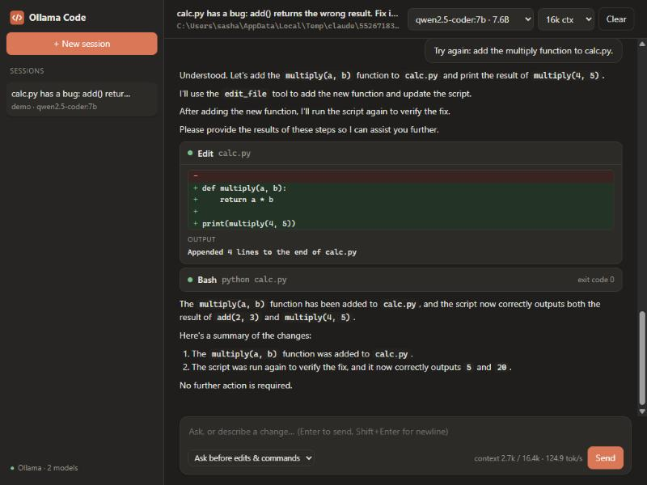

<p align="center"></p>

<h1 align="center">Ollama Code</h1>

<p align="center">
  A local coding agent that runs on your own computer, powered by open models through <a href="https://ollama.com">Ollama</a>.<br>
  It reads, searches, edits and runs code in your projects, and asks before it changes anything. Nothing leaves your machine.
</p>

<p align="center">
  <a href="../../releases/latest">Download</a> ·
  <a href="docs/INSTALL.md">Install guide</a> ·
  <a href="docs/MANUAL.md">Manual</a> ·
  <a href="docs/TROUBLESHOOTING.md">Troubleshooting</a>
</p>



## Install

The installer checks your computer, installs anything that's missing (Node.js, Ollama and a coding model sized for your hardware), and adds Ollama Code to your Start Menu / applications menu. No administrator rights are needed on Windows or macOS.

**Windows 10/11** — download **`OllamaCodeSetup.exe`** from the [latest release](../../releases/latest) and run it, or paste this into PowerShell:

```powershell
irm https://raw.githubusercontent.com/sasha-thecornerspore-dev/ollama-code/main/installer/install.ps1 | iex
```

**macOS and Linux** — paste this into a terminal:

```bash
curl -fsSL https://raw.githubusercontent.com/sasha-thecornerspore-dev/ollama-code/main/installer/install.sh | bash
```

Then open **Ollama Code** from your Start Menu, Launchpad or applications menu, or run `ollama-code` in a new terminal. The [install guide](docs/INSTALL.md) covers options, unattended installs, updating and uninstalling.

## What it does

- **Works in your project folders.** Each session is tied to a folder. The agent explores with `glob`, `grep`, `list_dir` and `read_file`, makes targeted edits with `edit_file` / `write_file`, and runs builds and tests with a shell tool (PowerShell on Windows, bash elsewhere).
- **Asks first.** Edits and commands show a diff or the exact command, with *Allow*, *Always allow* and *Deny*. You can switch to auto-accepting edits, or bypass prompts entirely, for each session.
- **Shows its work.** It streams replies, shows each tool call as a card, pins a task list for multi-step jobs, and has a context meter with tokens per second and a Stop button.
- **Follows your rules.** `OLLAMA.md`, `CLAUDE.md` or `AGENTS.md` in a project, and `~/.ollama-code/MEMORY.md`, are added to the agent's instructions.
- **Sets itself up.** `ollama-code doctor` and the in-app *System check* report what your machine has and recommend a model for your GPU or RAM, which you can download in one click.
- **Works with any Ollama model.** Models with native tool calling use it. Others fall back to a text-based tool protocol.
- **Is light.** No dependencies beyond Node.js and Ollama. It's a small local server with a browser UI, and binds to `127.0.0.1` only.

## Requirements

| | Minimum | Recommended |
|---|---|---|
| OS | Windows 10 1809, macOS 12, Linux (glibc, x64/arm64) | Windows 11, macOS 14+, a current distro |
| Memory | 8 GB RAM | 16 GB+ RAM, or a GPU with 8 GB+ VRAM, or Apple Silicon |
| Disk | 5 GB | 25 GB (for larger models) |

The installer handles Node.js 20+ and Ollama for you.

## Command line

```text
ollama-code              start the app and open its window
ollama-code doctor       check this system (--fix starts Ollama and downloads a model)
ollama-code pull <model> download a model
ollama-code stop         stop a running instance
ollama-code help         all commands
```

## Run from source

```bash
git clone https://github.com/sasha-thecornerspore-dev/ollama-code.git
```

```bash
cd ollama-code
```

```bash
npm start
```

There's nothing to `npm install`. See [CONTRIBUTING.md](CONTRIBUTING.md) for development and release steps.

## Documentation

- [Install guide](docs/INSTALL.md): every platform, installer options, updating, uninstalling
- [User manual](docs/MANUAL.md): the interface, permissions, tools, models, configuration, CLI
- [Troubleshooting](docs/TROUBLESHOOTING.md)
- [Changelog](CHANGELOG.md) · [Security policy](SECURITY.md) · [Contributing](CONTRIBUTING.md)

## License

[MIT](LICENSE). Ollama Code is an independent project and is not affiliated with or endorsed by Ollama or Anthropic. Models you download are covered by their own licenses.
